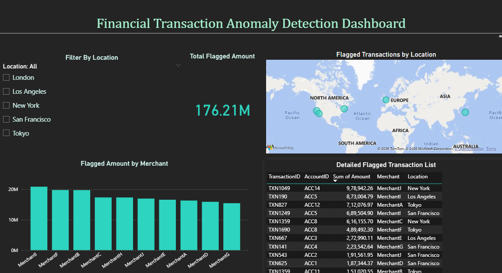

# Financial Transaction Anomaly Detection & Audit Reporting Dashboard

An end-to-end audit analytics pipeline that analyzes **217,441 real-world financial transactions** to detect anomalous, high-risk entries — simulating a real-world audit/claims investigation workflow from raw data to an executive-ready dashboard.

---

## Dashboard Preview



---

## Overview

This project takes a large financial transaction dataset and runs it through a full audit analytics pipeline:

1. **Data Extraction & Querying (SQL / MySQL)** — surfacing duplicate payments, high-value outliers, and merchant/location-level spend concentration
2. **Anomaly Detection (Python, scikit-learn)** — an Isolation Forest model statistically flags high-risk transactions beyond what fixed-threshold rules alone would catch
3. **Automated Reporting (Excel VBA)** — auto-formats and highlights exception reports, cutting manual report-prep effort
4. **Interactive Dashboard (Power BI)** — a 5-visual dashboard surfacing total flagged exposure, merchant risk ranking, and geographic distribution

---

## Key Findings

| Metric | Value |
|---|---|
| Total transactions analyzed | 217,441 |
| Transactions flagged as anomalous | 4,345 (≈ 2 %) |
| Total flagged exposure | ₹176.21 M |
| Merchants covered | 10 |
| Locations covered | 5 (New York, London, Tokyo, Los Angeles, San Francisco) |

---

## Anomaly Detection Approach

The notebook uses an **Isolation Forest** (unsupervised outlier detection) from scikit-learn:

- The model is trained on transaction amounts and learns what a "normal" transaction looks like from the data itself.
- Unlike fixed-rule thresholds (e.g. "flag anything above ₹50,000"), it isolates statistical outliers — catching risk patterns a manual rule would miss.
- `contamination=0.02` tells the model to expect roughly 2 % of transactions to be anomalous.
- Flagged transactions (`anomaly == -1`) are exported to `flagged_transactions.csv` for downstream reporting.

---

## SQL Audit Queries

The `audit_queries.sql` file contains:

| # | Query | Purpose |
|---|---|---|
| 1 | Top 20 highest-value transactions | Identify transactions carrying the highest inherent audit risk |
| 2 | Per-account transaction volume & total spend | Spot accounts with unusual concentration of activity/value |
| 3 | Duplicate payment detection | Flag same-account + same-amount repeats — a classic fraud red flag |
| 4 | Location-wise withdrawal pattern | Surface geographic concentration of withdrawal activity |

---

## Tools & Tech Stack

| Layer | Technology |
|---|---|
| Data Storage & Querying | SQL (MySQL) |
| Anomaly Detection | Python — Pandas, scikit-learn (Isolation Forest) |
| Automated Reporting | Excel VBA |
| Interactive Dashboard | Power BI (KPI card, bar chart, map, table, slicer) |

---

## Project Structure

```text
Financial-Anomaly-Detection/
├── anomaly_detection.ipynb   # Isolation Forest anomaly detection notebook
├── audit_queries.sql         # MySQL setup & audit queries
├── dashboard_screenshot.png  # Power BI dashboard screenshot
├── requirements.txt          # Python dependencies
├── .gitignore
└── README.md
```

---

## Getting Started

### Prerequisites

- Python 3.8+
- MySQL (for running the SQL audit queries)
- Jupyter Notebook or JupyterLab

### 1. Clone the Repository

```bash
git clone https://github.com/Jash275/Financial-Anomaly-Detection.git
cd Financial-Anomaly-Detection
```

### 2. Install Dependencies

```bash
pip install -r requirements.txt
```

### 3. Download the Dataset

The project uses the **Financial Anomaly Data** dataset from Kaggle.

1. Download `financial_anomaly_data.csv` from Kaggle.
2. Place the CSV file in the project root directory.

> **Note:** The dataset is not included in this repository due to size and licensing considerations.

### 4. Run the Notebook

```bash
jupyter notebook anomaly_detection.ipynb
```

Run all cells to reproduce the anomaly detection results. The notebook will output `flagged_transactions.csv` containing the flagged high-risk transactions.

### 5. SQL Queries (Optional)

To run the audit queries:

1. Import `financial_anomaly_data.csv` into a MySQL database using the setup commands in `audit_queries.sql`.
2. Execute the audit queries to explore high-value transactions, duplicate payments, and withdrawal patterns.

---

## Limitations & Assumptions

- The Isolation Forest is trained solely on the `Amount` feature; incorporating additional features (merchant, location, transaction type) could improve detection.
- The contamination rate of 2 % is a modelling assumption — in a production setting this would be tuned against labelled audit outcomes.
- The dataset is sourced from Kaggle and may not reflect the distribution of real financial institution data.

---

## License

This project is open-source and available for educational and portfolio purposes.
